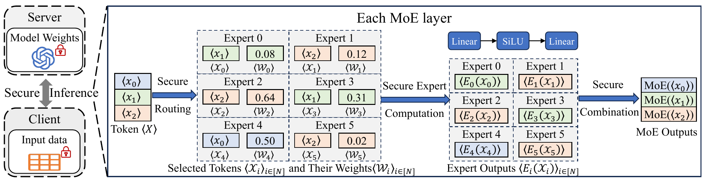

# Capricorn

<p align="center">
  <a href="https://www.apache.org/licenses/LICENSE-2.0"></a>
  <a href="https://openreview.net/forum?id=S71JaPVRqX"></a>
</p>

Capricorn is a framework for **secure Mixture-of-Experts (MoE) inference**. This release includes the Capricorn protocols, a CryptoMoE baseline, plaintext evaluations, and V-MoE end-to-end inference.

> Technical details: [Capricorn: Highly Efficient and Secure Mixture of Experts Inference Framework](https://openreview.net/forum?id=S71JaPVRqX).

## Table of Contents

- [Background](#background)
- [Key Features](#key-features)
- [Architecture Overview](#architecture-overview)
- [Project Structure](#project-structure)
- [Requirements](#requirements)
- [Getting Started](#getting-started)
- [Running Examples](#running-examples)
- [Contributing](#contributing)
- [Citation](#citation)
- [Acknowledgments](#acknowledgments)
- [License](#license)

## Background

Sparse MoE models route tokens to selected experts. Protecting that computation requires secure token selection, dispatch, expert computation, and output combination. Capricorn uses expert-choice token selection; the included CryptoMoE baseline applies token-wise Top-k followed by per-expert capacity selection. The repository provides both implementations for routing and complete MoE-layer experiments, together with secure SiLU and a V-MoE execution adapter.

## Key Features

- **Secure MoE primitives:** routing, dispatch, expert computation, combination, and activation.
- **Comparable experiment entrypoints:** Capricorn and serial/parallel CryptoMoE share one MoE-layer runner.
- **V-MoE end-to-end execution:** one entrypoint selects single/batch mode and LAN/WAN simulation.
- **Separate accuracy evaluation:** plaintext routing comparisons and fixed-point emulation for three MoE language models.
- **Bazel-managed C++ dependencies:** SPU, YACL, EMP-toolkit, and SEAL are resolved through the checked-in module configuration and patches.

## Architecture Overview

The secure MoE layer follows this flow:



`src/capricorn/` implements Capricorn, `src/baselines/cryptomoe/` implements the comparison baseline, and `src/common/` provides shared cryptographic and runtime components. The V-MoE adapter integrates the layer into full-model inference.

## Project Structure

| Directory | Contents |
| --- | --- |
| `src/capricorn/` | Capricorn protocols and secure activation |
| `src/baselines/cryptomoe/` | CryptoMoE baseline |
| `src/common/` | Shared cryptographic, runtime, selection, and neural-network components |
| `src/adapters/vmoe/` | V-MoE secure execution adapter |
| `benchmarks/` | C++ routing and MoE-layer benchmark targets |
| `experiments/` | Shell entrypoints for MoE-layer, SiLU, and V-MoE experiments |
| `python/capricorn_models/` | V-MoE export, asset preparation, execution, verification, and summaries |
| `plaintext/` | Plaintext model evaluation and fixed-point emulation |
| `bazel/` | Build rules and dependency patches |

Model weights, datasets, generated artifacts, results, logs, and COT caches must be prepared locally; they are not supplied as source code.

## Requirements

| Requirement | Details |
| --- | --- |
| Experiment platform | Linux x86_64; the optimized build uses native CPU instructions, including AVX2/AES |
| Build tool | Bazel 7.4.1, selected by `.bazelversion`; Bazelisk is supported |
| C++ toolchain | C++17 compiler with OpenMP, Make, CMake, pkg-config |
| Network experiments | User/network namespaces, `unshare`, `ip`, `tc`; `ping` for V-MoE |
| Timing utilities | GNU `timeout` for MoE; `/usr/bin/time` for SiLU |
| V-MoE Python | JAX/JAXLIB, NumPy, Pillow, msgpack |
| Plaintext Python | PyTorch, Transformers, Accelerate, lm-evaluation-harness, and model/data dependencies |

## Getting Started

### 1. Obtain the Source and Build

From the repository root, run `make help` to discover development commands,
benchmarks, V-MoE inference, and plaintext evaluation. Running `make` alone
also only prints help. Model checkpoints, datasets, and V-MoE artifacts still
need to be prepared explicitly as described below.

```bash
make cot_init  # Optional: prepare the two-party ROT smoke-test cache
make test      # Runs the lightweight ROT target, not the full test suite
make build     # Builds the five experiment targets listed below
```

`make test` checks the private local `.cache/cot-smoke-v1/` cache and generates
a fresh complete set if the files are missing or the checksums fail. It does
not require a shell `COT_DATA_DIR` setting or touch the persistent experiment
cache. Old cache generations are left in place. Set `BAZEL=bazel` if using a
compatible Bazel binary instead of Bazelisk. Experiment targets use the existing
scripts and their environment variables; for example, `make bench-routing
RUNS=1 CAPRICORN_NETWORKS=lan TOKEN_COUNTS=16 OUTPUT=results/routing_lan`.

Clone this repository or unpack its source release, then run commands from the repository root. Install [Bazelisk](https://bazel.build/install/bazelisk) and the system build tools above. Bazel resolves the C++ dependencies and patches declared in `MODULE.bazel`, including the patched SPU runtime. Build the five experiment targets:

```bash
bazelisk build -c opt \
  //benchmarks:capricorn_bench \
  //benchmarks:cryptomoe_bench \
  //src/common/nn:spu_activation_test \
  //src/capricorn/activation:secure_silu_test \
  //src/adapters/vmoe:pphlo_runner_main
```

### 2. Prepare Python Environments

Use a Python environment containing the V-MoE dependencies in the table above. Set `CAPRICORN_JAX_PYTHON=/path/to/python` to select it for the Shell entrypoint. For direct `python3 -m capricorn_models...` commands below, use that same interpreter. The repository does not lock a JAX/JAXLIB version combination; StableHLO compatibility with the patched SPU compiler must be checked in the selected environment. Official checkpoint restoration uses the local msgpack loader and does not require TensorFlow.

Use a separate PyTorch environment for plaintext evaluation. [`plaintext/requirements.txt`](plaintext/requirements.txt) records the original environment, including `transformers==4.49.0` and a pinned lm-evaluation-harness revision. It also mixes `torch==2.10.0+cu128` with CUDA 12.1 component pins and `triton==2.1.0`; it is not a validated fresh-install recipe. Select mutually compatible PyTorch/CUDA packages for your machine before running these evaluations.

### 3. Prepare Runtime Resources

Select a writable persistent COT cache with `COT_DATA_DIR`; the default is `capricorn/internal/cot_data` under the repository. Use distinct result directories for distinct experiment configurations. Model weights and evaluation datasets are prepared separately in the examples below.

LAN/WAN runs require Linux user/network namespaces, `unshare`, `ip`, and `tc`; V-MoE also uses `ping`. MoE-layer runs require GNU `timeout`, and SiLU timing uses `/usr/bin/time`. The scripts launch both parties on localhost and apply network shaping inside an isolated network namespace:

| Profile | Bandwidth limit | Configured one-way delay |
| --- | --- | --- |
| `native` | No shaping | No added delay |
| `lan` | 3 Gbit/s | 0.1 ms |
| `wan` | 400 Mbit/s | 20 ms |

These are simulated network profiles on one machine. The delay settings are not measured round-trip times or measurements from two physical hosts.

## Running Examples

The release has five Shell entrypoints:

| Entrypoint | Experiment |
| --- | --- |
| `experiments/moe/bench.sh` | Routing-only or complete MoE layer; Capricorn and CryptoMoE |
| `experiments/silu/run_silu.sh` | Secure SiLU performance or plaintext approximation error |
| `experiments/models/run_vmoe_model_e2e.sh` | V-MoE single/batch inference with selectable network profile |
| `plaintext/acc.sh` | Plaintext accuracy and fixed-point emulation |
| `plaintext/run_routing_fidelity.sh` | Routing assignments and output-fidelity comparison |

### Routing and MoE Layer

The existing Shell entrypoint runs Capricorn and serial/parallel CryptoMoE. The default sweep uses 16, 32, and 64 tokens, both LAN/WAN profiles, and five repetitions.

```bash
# Inspect the selected cases and two-party commands without executing them.
bash experiments/moe/bench.sh --dry-run

# One complete MoE-layer run per implementation.
TOKEN_COUNTS="16" CAPRICORN_NETWORKS=lan RUNS=1 \
bash experiments/moe/bench.sh results/moe_layer_lan

# Routing only, using the same entrypoint.
ROUTING_ONLY=1 TOKEN_COUNTS="16" CAPRICORN_NETWORKS=lan RUNS=1 \
bash experiments/moe/bench.sh results/routing_lan
```

| Variable | Meaning | Default |
| --- | --- | --- |
| `TOKEN_COUNTS` | Space-separated token counts | `16 32 64` |
| `IMPLEMENTATIONS` | Comma-separated implementation names | `cryptomoe_serial,cryptomoe_parallel,capricorn` |
| `CAPRICORN_NETWORKS` | `native`, `lan`, `wan`, or a comma-separated combination | `lan,wan` |
| `RUNS` | Repetitions per case | `5` |
| `ROUTING_ONLY` | `1` skips expert computation; `0` runs the complete layer | `0` |
| `EMBEDDING_DIMENSION` | Hidden dimension | `2048` |
| `EXPERT_DIMENSION` | Expert intermediate dimension | `1408` |
| `EXPERT_NUMS` | Number of experts | `64` |
| `TOP_K` | Active-expert parameter | `6` |

Use `CAPRICORN_SKIP_BUILD=1` to reuse an existing build. Results contain the command, both party logs, and exit statuses under `NETWORK/IMPLEMENTATION/tokens_N/run_N/`. The output directory must be empty.

### SiLU

```bash
# Secure SiLU performance, compared with the baseline.
RUNS=5 CAPRICORN_NETWORKS=lan,wan \
bash experiments/silu/run_silu.sh results/silu
python3 experiments/silu/summarize_silu_table3.py results/silu

# Plaintext approximation error, without MPC or network shaping.
RUNS=5 bash experiments/silu/run_silu.sh --accuracy results/silu_accuracy
```

Build the two activation targets before running performance experiments. The performance sweep uses vectors of length `2^18`, `2^20`, and `2^22`; the summary includes runtime and communication in JSON, CSV, and Markdown. `CAPRICORN_NETWORKS` accepts `lan`, `wan`, or `lan,wan`. The accuracy mode evaluates input ranges 8, 32, and 64. Each output directory must be empty.

### V-MoE End-to-End Inference

One Shell entrypoint selects single/batch execution, routing, and network profile. A first run can export synthetic parameters and an input, execute both parties, and compare their logits with the plaintext oracle:

```bash
bash experiments/models/run_vmoe_model_e2e.sh \
  --mode single --network native --routing both \
  --run-dir results/vmoe_synthetic
```

The synthetic example uses the full S/32 model dimensions and can be expensive; it does not measure official-checkpoint accuracy. For a real image, obtain the official `vmoe_s32_last2_ilsvrc2012_randaug_light1` checkpoint separately. Its prefix must have matching `.index` and `.data-00000-of-00001` files; the loader validates the supported shard's size and digest. Export each routing variant once:

```bash
for routing in token_choice expert_choice; do
  PYTHONPATH="$PWD/python" python3 -m capricorn_models.export_vmoe_model \
    --checkpoint_prefix /path/to/vmoe_s32_last2_ilsvrc2012_randaug_light1 \
    --image /path/to/image.jpg \
    --routing_mode "$routing" --output_dir "assets/vmoe_base/$routing"
done

bash experiments/models/run_vmoe_model_e2e.sh \
  --mode single --network lan \
  --artifact-dir assets/vmoe_base/token_choice \
  --run-dir results/vmoe_single_lan
```

For checkpoint-based export, the default profile, `research`, uses GELU in dense blocks and SiLU in MoE experts. `--profile official_fidelity` selects GELU in MoE experts as well. Keep the profile explicit when interpreting accuracy results.

For the Imagenette-50 batch experiment, prepare the dataset and per-sample artifacts before selecting batch mode:

```bash
# Uses the cached archive when valid; otherwise downloads Imagenette.
PYTHONPATH="$PWD/python" python3 -m capricorn_models.vmoe_imagenette dataset \
  --archive assets/imagenette2-320.tgz --output_dir assets/imagenette50

PYTHONPATH="$PWD/python" python3 -m capricorn_models.vmoe_imagenette prepare \
  --checkpoint_prefix /path/to/vmoe_s32_last2_ilsvrc2012_randaug_light1 \
  --manifest assets/imagenette50/manifest.json --image_root assets/imagenette50 \
  --token_base_dir assets/vmoe_base/token_choice \
  --expert_base_dir assets/vmoe_base/expert_choice \
  --output_root assets/vmoe_prepared

bash experiments/models/run_vmoe_model_e2e.sh \
  --mode batch --network wan --routing both \
  --manifest assets/imagenette50/manifest.json \
  --artifact-root assets/vmoe_prepared/artifacts \
  --run-dir results/vmoe_batch_wan

PYTHONPATH="$PWD/python" python3 -m capricorn_models.summarize_vmoe_imagenette \
  --manifest assets/imagenette50/manifest.json \
  --artifact_root assets/vmoe_prepared/artifacts \
  --run_root results/vmoe_batch_wan --output_dir results/vmoe_batch_summary
```

Batch preparation expects the two real-checkpoint `research` base artifacts exported above and a 50-sample manifest. It hardlinks model operands, so keep base artifacts and the preparation output on the same filesystem and leave them unchanged during execution.

`--network` accepts `native`, `lan`, or `wan`; `--routing` accepts `token_choice`, `expert_choice`, or `both`. An existing single artifact represents one routing mode. Batch artifacts are read from `ARTIFACT_ROOT/ROUTING/SAMPLE_ID`. Repeating a batch invocation with the same configuration and `--run-dir` resumes validated completed samples. `--timeout` controls the time limit per two-party run; `--skip-build` reuses the runner. Single runs write per-routing outputs and `verification.json`; batch runs write per-sample summaries and `progress.json`.

### Plaintext Evaluation

Prepare the model checkpoints, tokenizer files, and evaluation datasets separately. Keep the repository's customized `config.json`, configuration, and modeling files when adding checkpoint/tokenizer assets to each model directory; replacing them with upstream source files changes the evaluation behavior. Model loading uses local files. The supported models are `deepseek-moe-16b-base`, `Qwen1.5-MoE-A2.7B`, and `OLMoE-1B-7B-0125-Instruct`.

```bash
MODEL=OLMoE-1B-7B-0125-Instruct MODEL_PATH=/path/to/model \
MODE=capricorn-piecewise-fixed PYTHON_BIN=python3 \
BATCH_SIZES_OVERRIDE="16" DATASETS_OVERRIDE="piqa" \
LOG_DIR=results/plaintext_accuracy bash plaintext/acc.sh
python3 plaintext/parse_results.py --log-dir results/plaintext_accuracy

MODEL_PATH=/path/to/deepseek-moe-16b-base PYTHON_BIN=python3 \
BATCH_SIZE=64 FULL=1 OUTPUT=results/routing_fidelity.json \
bash plaintext/run_routing_fidelity.sh
```

Accuracy modes are `original`, `float-all-experts`, `capricorn-piecewise-fixed`, `capricorn-polynomial-fixed`, `cryptomoe-piecewise-fixed`, and `cryptomoe-polynomial-fixed`. The full accuracy sweep uses batch sizes 16/64 and six datasets: OpenBookQA, ARC-Easy, ARC-Challenge, HellaSwag, PIQA, and WinoGrande. The routing-fidelity script uses the same six datasets and defaults to offline dataset/model access; populate those caches first. `FULL=0 LIMIT=4` selects a small routing smoke run. See `bash plaintext/acc.sh --help` and `bash plaintext/run_routing_fidelity.sh --help` for configuration.

These scripts evaluate plaintext floating-point or fixed-point emulation. They do not execute the secure protocol or provide MPC runtime measurements.

## Contributing

Please describe the affected protocol or experiment, provide the relevant command and configuration, and build or test the targets your change touches. Keep generated artifacts, model weights, datasets, caches, and result logs out of source contributions. Read [LEGAL.md](LEGAL.md) for the comment-language disclaimer.

## Citation

If you use Capricorn in your research, please cite [Capricorn: Highly Efficient and Secure Mixture of Experts Inference Framework](https://openreview.net/forum?id=S71JaPVRqX).

## Acknowledgments

The C++ implementation builds on SecretFlow SPU and YACL, EMP-toolkit, Microsoft SEAL, and other dependencies declared in `MODULE.bazel`. V-MoE export uses JAX. Plaintext evaluation uses Hugging Face Transformers and the EleutherAI Language Model Evaluation Harness. V-MoE experiments use the original V-MoE model checkpoint and Imagenette images.

## License

Core Capricorn source files carry [Apache License 2.0](https://www.apache.org/licenses/LICENSE-2.0) notices. Third-party components and model assets retain their respective licenses, including the licenses bundled under `plaintext/`. [LEGAL.md](LEGAL.md) contains the comment-language disclaimer; it is not a license grant.

Copyright 2026 Ant International, Ant Group. All rights reserved.
